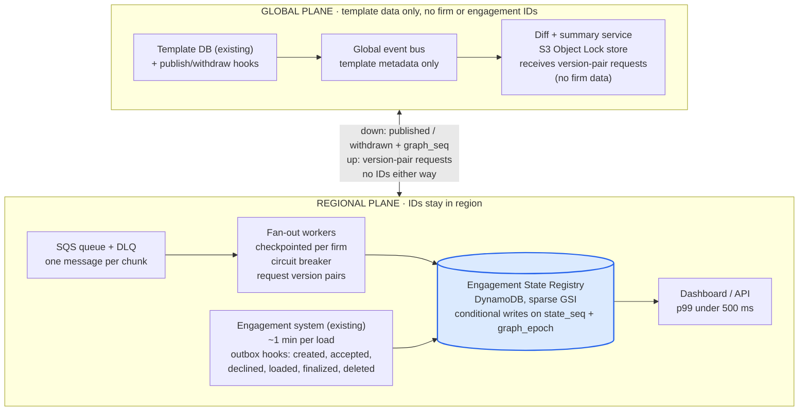
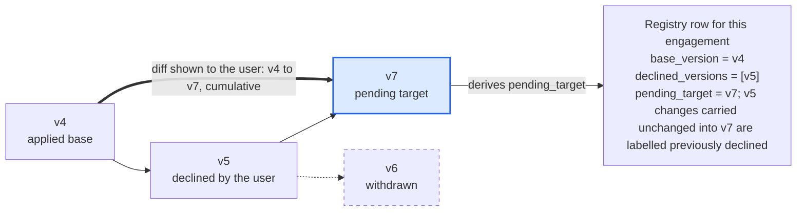

# Design Document: Template Update & Notification System for Engagement Files

Nov 13, 2026 · @Darkcarard

## 1. Architecture and Data Ownership

The global plane knows about templates; the regional plane knows about firms. Nothing that identifies a firm or an engagement ever leaves its region (ownership table in Appendix A).

Only template metadata crosses into a region, and version-pair requests leave it without IDs. The registry (highlighted) is the one store the engagement system writes and the dashboard reads.

- **Decoupled read model.** Opening an engagement takes \~1 minute (hard constraint), so "pending" is read from a registry that is a derived copy of state the engagement system owns. We never scan engagements.
- **No re-platforming.** Templates stay in the existing database; we only add publish and withdraw hooks. Template-derived artifacts are global, and firm-derived views (such as "previously declined" labels) are computed in-region at read time.
- **Hooks via transactional outbox.** Engagement system: `created` (with `source_engagement_id` on roll-forward), `accepted`, `declined`, `loaded`, `finalized`, `deleted`, each with a monotonic `state_seq`. Template DB: `published`, `withdrawn`, each with a per-product `graph_seq` so every region applies graph changes in order.
- **Residency boundary.** Only template metadata, global diffs and summaries, and ID-free metrics cross regions. Alarm on any global-bus event that carries a firm or engagement ID. The boundary is enforced by account and IAM, not by convention.
- **Isolation and outage.** The regional API takes `firm_id` from the caller's token, never from the request, and regional data uses per-region KMS keys. If the global plane is down, regions keep serving from the registry and template events wait in the source outbox.
## 2. Correctness and Production Evolution

A publish never loads an engagement. The 1-minute load is paid only by the one-time backfill, the user's accept/decline path, and sampled reconciliation. Steady-state fan-out touches only the registry.

Declining v5 records it in `declined_versions` and leaves `base_version` at v4, so the v7 diff includes v5's changes, labelled as previously declined. v6 was withdrawn and is never offered.

- **Registry row** (PK `firm_id`, SK `engagement_id`): `base_version`, `declined_versions`, `state_seq`, and a derived `pending_target`. A sparse GSI over pending rows serves the dashboard in under 500 ms, even for the 40,000-file firm (details in Appendix A). Engagements not yet seeded return `UNKNOWN`, never a guess, and the dashboard shows "Checking N files".
- **Version graph.** Each region holds a small projection of `(product, market, version, parents, status)` with no template content. `pending_target` is a pure function: the latest published descendant of `base_version` in the engagement's market lineage that is not in `declined_versions`.
- **What "declined" pins.** Nothing about content. `base_version` keeps describing the file, and declining only records the version so the user is not re-prompted. When v7 arrives (it contains v5), the diff is always computed from `base_version`, and the summary labels v5's changes that v7 carries unchanged as "previously declined" (rule in Appendix F). Several accumulated updates collapse into one cumulative diff.
- **Lifecycle.** `accepted` advances `base_version`, `finalized` locks the row so a signed-off file is never offered updates, `deleted` removes it, and a roll-forward inherits `base_version` from its source (Appendix F).
- **Withdrawal.** Bump the graph epoch and re-run the same fan-out. Affected rows fall back to the previous version or stop being pending, and the notification is retracted. An already-applied version that is later withdrawn raises a separate advisory.
- **Unreliable delivery.** Every write is conditional and derivation is pure, so duplicates, out-of-order events, retries and DLQ replays are no-ops. Hook writes require `state_seq < :incoming`. Fan-out writes require `state_seq = :seen AND graph_epoch <= :epoch`, so neither a user decision nor a newer graph epoch is ever overwritten. Race handling is in Appendix F.
- **Failure recovery.** Chunked fan-out (one SQS message per at most 500 rows) with a cursor per `(publish, firm, chunk)` checkpointed every few dozen rows, so the 40,000-row firm resumes where it stopped. A circuit breaker on downstream 429/5xx and registry throttling stops workers from pulling. A corrupt row is quarantined and counted without failing its chunk; only a corrupt lineage poisons the chunk, which goes to the DLQ and is replayed by runbook. Accepts (each a ~1 minute load) are queued under the same caps as the backfill.
- **Reconciliation.** A weekly 0.5% sample (about 4,000 loads, 67 compute-hours), evaluated over a rolling 8-week window so a 0.01% drift rate is statistically provable (Appendix F), plus a free check on every `loaded` event. Drift above threshold triggers a per-firm re-seed.
- **Live migration, no maintenance window.** (1) Ship hooks dark. (2) Shadow mode: the registry fills from hooks and `loaded` events while the UI is unchanged. (3) Throttled backfill of the remaining rows, off-peak, with a kill switch. (4) Per-firm feature flag once coverage is 100% and a drift sample passes. Rollback is flipping the flag, because the registry is purely additive.

## 3. Scale, Cost and Operational Characteristics

Steady state is about \$350 to \$600 per month, 75% to 85% of it inference, for 800,000 files, 4,000 firms and 40 products publishing about weekly. Prices are list-price estimates; full arithmetic is in Appendix B.

| Item | Arithmetic | Result |
| --- | --- | --- |
| Registry writes | At most 800,000 rewrites/week | \~1.3 writes/s; largest firm (40,000 rows) in \~3.3 min |
| Downstream loads per publish | Registry-only fan-out | 0 |
| Backfill compute | 800,000 files x 1 min = 13,300 hours | \~5.6 days at 100 concurrent loads (assumption to confirm); \~\$1,300 one-time |
| Largest firm in backfill | 40,000 min = 667 hours | \~2.8 days under a per-firm cap of 10 |
| Summaries | Unit is (product, market, from, to, locale), not the publication; 200 to 400 pairs/week | \~\$250 to \$500/month |
| Steady-state total | Registry, queues, inference, S3 WORM, observability | \~\$350 to \$600/month |

The design requires `$X` above about \$600/month; a daily inference cap falls back to deterministic structured summaries instead of blocking publication. Deduplicating to version pairs makes about 2,000x fewer calls than per-engagement inference; the main cost sensitivity is diff size (Appendix B).

## 4. Generation and Evaluation of Human-Readable Summaries

The stored artifact is the evidence, not the model: LLM output is not reproducible even at temperature 0, so defensibility comes from an immutable record of what was generated, checked and shown.

- **Unit and input.** One summary per `(product, market, from, to, locale)`, generated once and shared by all firms. The model sees only the deterministic JSON diff, never templates or firm data. Template text inside the diff is treated as data in the prompt, never as instructions. Every statement cites the diff paths it came from.
- **Pipeline.** (1) Model A generates from the diff. (2) Deterministic checks, no LLM: every changed path is covered, every cited path exists, numbers and identifiers match the diff verbatim, and added/removed/modified are not swapped. (3) Model B, a different model, judges for omissions, hallucinations and misleading emphasis. (4) Up to 2 retries with the failure reasons. (5) If checks still fail, or the spend cap trips, publish a structured deterministic rendering of the diff and alert the content team. Users never see an unchecked summary and always get a correct one.
- **Evaluation.** A golden set of about 100 historical diffs runs on every model or prompt change, and the judge is calibrated monthly against seeded errors (Appendix C).
- **March versus November.** Diffs, summaries and generation records live in S3 with Object Lock (WORM, compliance mode) under content-addressed keys. Every accept or decline event stores the `summary_hash` the user saw, so we can show the exact text, and the evidence it was checked, without regenerating. Corrections create new objects and never overwrite (record fields in Appendix C).
- **Limit.** Summaries inform the decision and are not authoritative. The UI links to the structured diff so a practitioner can verify any statement.

## 5. Key Tradeoffs, Assumptions and Challenged Requirement

| Decision | Chosen | Rejected | What we give up |
| --- | --- | --- | --- |
| Source of "pending" | Regional registry fed by hooks and `loaded` events | Scanning or loading engagements | Strict consistency; we accept a bounded, measured staleness |
| Summaries | LLM, deterministic checks, judge, structured fallback | LLM only | Polish, when the budget cap trips |
| Caching engagement state | Rejected | Redis of loaded state | Nothing. Volatile fields are established only on rehydration, so a cached copy is not a valid representation |

**Assumptions** are listed in Appendix D (further tradeoffs in Appendix G). The most important to verify is that the owning team grants about 100 concurrent loads (per-firm cap 10) for the backfill.

**Requirement challenged: "real-time, within seconds of publication."** We split it by what the user sees. The pending badge is seconds typically and under 5 minutes at p99, because publish never loads an engagement. The summary is ready under 15 minutes at p95, and accept/decline stays disabled until it is attached, since users must not decide without it. Files not yet seeded during the backfill show "Checking..." for up to days, governed by downstream capacity. What we guarantee is a fresh indicator with a measured drift rate, not fresh truth about every file. A confident wrong answer is the failure to avoid.

**Riskiest component: registry drift.** The registry is a derived copy of state it does not own. A false negative (a firm never sees an update) is the dangerous case. Mitigations are conditional writes on `state_seq` and `graph_epoch`, the outbox, `loaded` events as free ground truth, reconciliation with a drift SLO over a rolling 8-week sample, and `UNKNOWN` instead of guessing. Second riskiest: the version-graph semantics (branching, withdrawal, declined pinning), which we validate with content teams on real historical version trees before cutover.

**Deliberately left out:** dashboard UI/UX; applying templates and remediation of a withdrawn applied version; cross-user conflict resolution (we rely on the engagement system); the authorization model; the content-team approval workflow (hook only); notification channels beyond the in-app badge; multi-region disaster recovery (in-region point-in-time recovery only, Appendix F); languages beyond a locale parameter.

## 6. Observability and SLOs

We alert on user-visible symptoms and hard invariants. Telemetry with firm or engagement IDs stays in the regional account; only ID-free aggregates reach a global dashboard.

| SLO | Target |
| --- | --- |
| Dashboard read latency and availability | p99 under 500 ms, 99.9% available |
| Registry freshness (publish to all affected rows evaluated, in region) | p99 under 5 min, largest firm included |
| Registry accuracy (drift from reconciliation) | Under 0.01% over a rolling 8-week sample (32,000 rows); confirmed drift fixed within 24 h |
| Summary readiness (judge-passed or deterministic fallback) | p95 under 15 min |
| Fan-out reliability | No DLQ message older than 1 h; downstream 429/5xx under 1% |
| Inference cost | Under 100% of budget; alert at 80% of the daily cap |

**Hard invariants (page on any violation):** downstream concurrency never exceeds the granted global and per-firm caps; every shown summary has a WORM generation record; every accept or decline stores the `summary_hash` seen; no firm or engagement ID appears on the global bus.

**Operations.** A backfill dashboard gates the per-firm cutover, and a weekly synthetic canary checks the SLOs end to end in each region. Runbooks, alerting and tracing are in Appendix D; tests are in Appendix E.

## Appendix

### A. Data ownership and registry data model

| Plane | Component | Owner | Firm/engagement IDs |
| --- | --- | --- | --- |
| Global | Product Template DB (existing, unchanged) plus new `published` / `withdrawn` hooks | Content team | No |
| Global | Diff and summary service, immutable store | This feature | No |
| Regional (`eu-central-1`, `ca-central-1`, ...) | **Engagement State Registry** (DynamoDB), version-graph projection, fan-out workers, SQS/DLQ, logs, traces | This feature | Yes, in-region only |
| Regional | Engagement files and the \~1 min load/apply path | Engagement system (existing) | Yes |

**Registry (regional DynamoDB):**

| Attribute | Purpose |
| --- | --- |
| `PK=firm_id`, `SK=engagement_id` | A firm's rows share a partition and are paginated per firm |
| `product_id`, `market` | Which version lineage applies |
| `base_version` | The version whose content is actually in the file |
| `declined_versions` (string set) | Versions the user already declined |
| `state_seq` | Monotonic per-engagement counter from the engagement system, used in conditional writes |
| `pending_target`, `pending_since` | Derived; absent when nothing is pending |
| `graph_epoch` | Version-graph epoch the row was last evaluated against; fan-out and backfill writes require `graph_epoch <= :epoch` |
| `locked` | Set by `finalized`; a locked row never gets a `pending_target` |
| `source` | `hook`, `backfill` or `reconciled`, for provenance |

- **GSI-1 (sparse):** `PK=firm_id`, `SK=pending_since`, projected only for rows with a `pending_target`. The dashboard query returns only pending items, 50 per page.
- **GSI-2 (fan-out lookup):** `PK=product_id#market#shard(0..15)`, `SK=firm_id#engagement_id`. The shard suffix avoids a hot key.
- **Coverage item:** `PK=firm_id`, `SK=#COVERAGE`, holding counts of seeded and unseeded engagements. It drives "Checking N files" and the backfill dashboard.
- **Derivation:** `pending_target = latest PUBLISHED descendant of base_version in the market lineage, not in declined_versions` (none if the row is `locked`). "Latest" is the highest `graph_seq`, and reachability ignores status, so a withdrawn version does not hide its descendants. Pure function of `(base_version, declined_versions, locked, graph)`, recomputed on every hook write and every fan-out.

### B. Cost and capacity arithmetic

All prices are illustrative list prices; confirm against current pricing and negotiated rates.

**Registry.** 800,000 rewrites/week, 2 writes each (table plus sparse GSI) = 1.6M write units/week at about \$1.25 per million, about \$2/week or \$10/month. Storage is 800,000 x 0.5 KB = 400 MB (under \$1/month). Largest firm burst: 40,000 rows at about 200 writes/s is about 3.3 minutes.

**Backfill.** 800,000 x 1 min = 48M s = about 13,300 compute-hours.

| Granted concurrency | Duration |
| --- | --- |
| 50 | \~11 days |
| 100 (planning baseline) | \~5.6 days |
| 200 | \~2.8 days |

The largest firm needs 667 hours; a per-firm cap of 10 means about 2.8 days for that firm alone. With weighted round-robin across firms at 100 slots, a median firm (40 files) finishes in about 27 hours. One-time compute is about 13,300 pod-hours x \$0.10 = \$1,300 (assumed pod size, charged to the downstream owner). Files opened during the backfill are seeded free by `loaded` events.

**Inference.** About 40 products x 5 distinct baselines in use = 200 pairs/week, planned at 400 for branches and withdrawals (about 1,730/month). Assumed tokens per pair, including the judge and retries: the generator and the judge each read the diff (assumed about 25k tokens plus about 3k of prompt), so the first attempt is about 56k in. Retries (x1.5 expected attempts) reuse a prompt-cached diff and add about 8k, for about 64k in and 3k out. At \$3 per million input and \$15 per million output that is about \$0.24 per pair, so about \$415/month, and about \$500/month with a 20% allowance for locales (200 pairs: about \$250/month). Locale multiplies the pair count, so verify the 20% against the real locale list per region. Per-engagement inference would cost about \$190k/week. Sensitivity: at 50k-token diffs the cost is about \$0.40 to \$0.45 per pair, roughly \$850 to \$950/month including locales.

| Component | Per month |
| --- | --- |
| DynamoDB (registry and GSIs) | \~\$10 |
| SQS, EventBridge, workers | under \$20 |
| Inference (generation, judge, locales) | \$250 to \$500 |
| S3 WORM (about 20 MB/week) | under \$1 |
| CloudWatch logs, metrics, X-Ray | \~\$50 |
| **Steady-state total** | **\~\$350 to \$600** |
| One-time backfill compute | \~\$1,300 |

### C. Summary generation record and evaluation

One immutable record per published summary, stored beside it in S3 Object Lock (compliance mode, versioning on, `sha256` content-addressed keys, retention set to the regulatory period).

| Field | Why |
| --- | --- |
| `diff_hash`, `diff_tool_version` | Proves what the summary was generated from |
| `model_id`, `prompt_version`, parameters | Identifies what produced it |
| Deterministic check results | Shows coverage and fidelity checks passed |
| `judge_model_id`, `judge_prompt_version`, verdict, reasons | Shows independent review |
| `attempt_count`, `fallback_used` | Shows whether it was LLM-written or structured |
| `output_hash`, `locale`, `created_at` | Identifies the exact text |
| `approved_by` (if human-gated) | Shows who signed off |

- **Triggers.** A `published` event generates the common pair (previous latest to new). Rarer pairs (a firm several versions behind, or one that declined v5) are enqueued by the regional fan-out, which already knows every distinct `(base_version, pending_target)` in its region. The request carries only `(product, market, from, to, locale)`, no firm data, and is deduplicated globally, so these pairs are usually ready before a user opens the dashboard. Pairs that appear between fan-outs are generated on first need and cached.
- **Golden set.** About 100 historical diffs, including adversarial cases (removed requirement, changed threshold), run on every model or prompt change. Each locale is generated from the diff, not translated, and validated separately.
- **Firm context stays regional.** The global summary describes `from -> to` only; the regional API marks previously declined changes at read time.
- **Large diffs.** A diff over the model's context budget is split by template section. Each section is summarized and checked on its own, the results are merged, and the deterministic checks run again on the merged summary.
- **Judge calibration.** Humans review a sample of verdicts monthly. We inject known errors and track the judge's false-pass rate.
- **Online signals.** First-attempt pass rate (ticket below 90%), fallback rate, and user feedback that a summary is unclear or wrong.
- **Corrections.** A fix is a new object and the registry points to it. The old one stays, and affected users are found through the stored `summary_hash` values.

### D. SLIs, alerting and assumptions

**Additional SLIs:** event propagation (template DB publish to regional receipt, p99 under 1 min); backfill coverage and ETA; downstream in-flight loads against the granted cap; judge first-attempt pass rate; inference spend against budget; DLQ age.

| Severity | Condition | Action |
| --- | --- | --- |
| Page | Any hard-invariant violation; downstream cap exceeded; registry freshness or accuracy SLO burning at 10x; DLQ age over 1 h | On-call runbook |
| Ticket | Judge first-attempt pass rate under 90%; inference at 80% of the daily cap; drift in a single firm | Next business day |
| Info | Circuit breaker opened or closed; backfill ETA change | Dashboard only |

**Telemetry fields.** Every log line and trace carries `publish_id`, `product_id`, `template_version`, `firm_id` and `chunk_id`, never engagement content.

**Operations.** The backfill dashboard shows coverage per firm, burn-down and ETA, and downstream health. The weekly synthetic canary publishes a test version end to end per region and asserts the SLOs. Runbooks cover DLQ replay, firm re-seed, backfill kill switch, tripping the inference cap, and re-evaluation after a withdrawal.

Use multi-window burn-rate alerts (1 h and 6 h) for the latency, freshness and summary SLOs. Tracing: one X-Ray trace per publish through bus, regional queue, worker and registry write, with downstream loads as linked spans.

**Assumptions to confirm in the design review:**

1. The engagement system emits `created` (with `source_engagement_id` on roll-forward), `accepted`, `declined`, `loaded`, `finalized` and `deleted` through a transactional outbox, each with a monotonic per-engagement `state_seq`.
2. The template DB emits `published` and `withdrawn` with a per-product `graph_seq`, and every version has a known `market` and parent edges.
3. The owning team grants about 100 concurrent engagement loads for the backfill (per-firm cap 10) and honors a kill switch. This drives the 5.6-day estimate and is the most important number to verify.
4. The engagement system already serializes concurrent accept/decline actions on one engagement; the registry has its own conditional writes and does not depend on this.
5. The budget `$X` exceeds about \$600/month for steady state; otherwise low-risk changes use structured-only summaries.
6. Template diffs are deterministic and fast (per the brief), and diffs and summaries contain no firm data, so they may be stored globally.
7. A load returns the engagement's current `state_seq`, so backfill and reconciliation writes can be conditional.
8. The engagement system can list a firm's engagement IDs, with product and market, without loading files, so unseeded engagements can be counted and shown as `UNKNOWN`.
9. Average diff size is about 25k tokens; this drives the inference estimate (Appendix B).

### E. Test strategy

- **Contract tests** on the outbox event schemas, shared with the engagement and template teams.
- **Property tests** of `pending_target` over generated version graphs (branches, withdrawals, declines, roll-forward), plus replay of real historical version trees with the content teams.
- **Chaos tests:** duplicated, reordered and dropped events; workers killed mid-chunk; publish racing withdrawal; DLQ replay. Every scenario must converge to the same registry state as a clean run.
- **Load test:** a synthetic 40,000-row firm fan-out against the freshness SLO, with registry throttling and downstream 429s injected.
- **Summary evaluation:** the golden set (Section 4) runs in CI on every model or prompt change.

### F. Version semantics, write conditions and recovery

**Lifecycle events.**

| Event | Effect on the row |
| --- | --- |
| `created` | New row; `base_version` is the creation version |
| `created` (roll-forward) | Inherits `base_version` from the source file, because its content was copied; starts with empty `declined_versions` so the new period's team re-evaluates earlier declines (to confirm with product) |
| `accepted` | `base_version` becomes the accepted version; its ancestors are removed from `declined_versions` |
| `declined` | The version is added to `declined_versions` |
| `finalized` | Row is `locked` (signed off or archived): it leaves the pending index and is never offered updates |
| `deleted` | Row is removed |

**"Previously declined" label.** A change in the `base_version -> target` diff gets the label only if its path appears in the `base_version -> declined` diff and its value in the target equals its value in the declined version. If a later version changed it again, it is shown as a new change.

**Write conditions.**

| Writer | DynamoDB condition | Prevents |
| --- | --- | --- |
| Hook | `attribute_not_exists(state_seq) OR state_seq < :incoming` | Duplicate and out-of-order events |
| Fan-out | `state_seq = :seen AND graph_epoch <= :epoch` | Overwriting a user decision made mid-flight, or a newer graph epoch |
| Backfill and reconciliation | Hook rule, using the `state_seq` returned by the load, `AND (attribute_not_exists(graph_epoch) OR graph_epoch <= :epoch)` | A slow load overwriting a newer hook, or re-offering a version withdrawn during the load |

**Races.**

- *User decides mid-fan-out:* the fan-out write fails on `state_seq`, and the worker re-reads and recomputes.
- *Publish racing a withdrawal:* neither changes `state_seq`, so without the epoch condition an older fan-out could finish last and re-offer a withdrawn version. `graph_epoch <= :epoch` rejects it.
- *Withdrawal during a backfill load:* the 1-minute load can straddle a graph change. The epoch condition fails, and the worker re-derives against the fresh graph without reloading. The epoch written is always that of the graph the target was derived from.
- *Engagement created during a fan-out:* every hook write recomputes `pending_target` against the current graph. A row written just before the graph update, or missed by the eventually consistent GSI-2, is caught by a periodic sweep that re-evaluates any row whose `graph_epoch` lags the current one.

**Drift statistics.** With zero drift observed in *n* samples, the 95% upper bound is about 3/*n* (rule of three). One week (4,000 samples) only bounds drift below 0.075%, so the 0.01% SLO is evaluated over a rolling 8 weeks (32,000 samples, bound about 0.009%). Every `loaded` event is also compared with its row before it is applied: a continuous, free signal, biased toward active files.

**Unseeded engagements.** They are known from the engagement system's ID listing, which needs no load. The sparse GSI cannot list them, so the coverage item (Appendix A) counts them for "Checking N files".

**Accept surge.** After a major publish, accepts go through a regional queue under the same global and per-firm caps as the backfill. The UI shows "Applying..." and the row updates on the `accepted` event.

**Registry recovery.** DynamoDB point-in-time recovery restores a corrupted table in hours. A rebuild without backups means re-running the ~5.6-day backfill.

### G. Further tradeoffs

| Decision | Chosen | Rejected | What we give up |
| --- | --- | --- | --- |
| Pending state | Materialized with a sparse GSI | Computed on every read | \~\$10/month in writes and a re-evaluation pass on withdrawals |
| Diffs and summaries | Pairs discovered by fan-out, plus on demand per immutable key, cached | Pre-computing all pairs (O(n^2) across branches) | A first-request delay only for pairs that appear between fan-outs |
